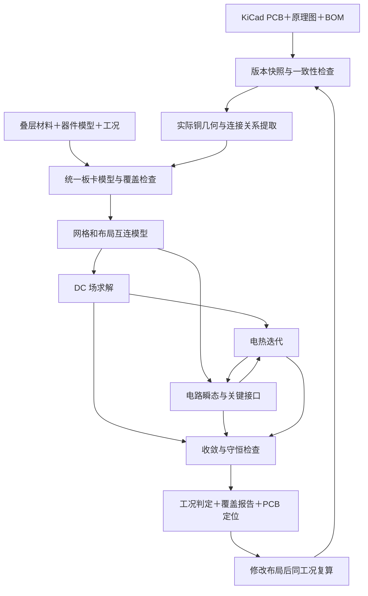

# PCB 后布局系统仿真平台：需求与完整链路设计

版本：设计草案 v0.1｜调研日期：2026-10-14｜状态：只做方案，未编程、未安装或运行求解器。

本文区分用户已确认需求、设计建议、官方文档能力和待验证能力。配套清单见 [02_开源与商业工具调研.md](02_开源与商业工具调研.md)。

## 1. 产品定义与已经确认的需求

产品定位：面向个人及小团队的、本地运行的 KiCad 后布局电路—PCB—热联合验证平台。以完成布线和铺铜的真实 PCB 为物理输入，结合原理图、器件模型和工况，在打板前发现供电、温升、上电时序、模拟响应和关键接口问题，并把结果定位回具体器件、引脚、走线、过孔和铜皮。

| 维度 | 用户已确认的决定 |
|---|---|
| 首发设计格式 | KiCad，后续扩展其他格式 |
| 运行环境 | macOS，优先适配当前电脑 |
| 用户与成本 | 个人/小团队，优先全开源和本地运行 |
| 板卡类型 | MCU＋传感器＋电源的嵌入式控制板 |
| 第一版边界 | 暂定 2–4 层、低压、常见 LDO/DC-DC、GPIO/I²C/SPI/UART/ADC |
| 第一版目标 | 供电可靠性、温升、上电/掉电时序、模拟响应、关键接口电气行为 |
| 固件执行 | 后续阶段接入，第一版采用负载和行为模型 |
| 可提供输入 | 原理图、BOM、芯片型号、工况，逐步补齐模型 |
| 精度与时间 | 准确性优先，接受几十分钟至数小时 |
| 当前工作 | 需求、社区调研、技术路线与验收方案；不开发软件 |

尚未确定：具体板尺寸、电源电压与最大电流、MCU/传感器型号、接口边沿时间、负载波形、环境温度、板厂叠层与铜厚、电脑 CPU 架构与内存。这些是后续标杆板参数，不用虚构默认事实，也不妨碍先确定架构。

## 2. “真实仿真”和“完整度”的可执行定义

后布局仿真已经存在于商业工具中，例如 SIwave、HyperLynx 和 Sigrity。项目价值在于把真实布局、电路功能、模型管理、工况和验证证据整合成适合小团队的开源工作流，而不是宣称首次实现 PCB 物理仿真。[SIwave](https://ansys.synopsys.com/products/electronics/ansys-siwave)、[HyperLynx](https://www.siemens.com/en-us/products/pcb/hyperlynx/)、[Cadence EM](https://www.cadence.com/en_US/home/tools/system-analysis/em-solver.html)

PCB 文件能提供几何、连接和部分材料信息，但通常不能完整提供芯片内部行为、工作电流波形、控制环路、热边界及外部负载。真实仿真需要：PCB 几何＋设计连接关系＋材料＋器件模型＋激励/边界条件＋判定标准。

原理图仿真仍然是必要组成部分：把理想导线替换成由真实布局提取的互连模型，再与器件行为联合求解。KiCad 内置 ngspice 目前主要通过原理图编辑器提供电路仿真；我们的设计要补上后布局提取和联合验证链路。[KiCad SPICE](https://www.kicad.org/discover/spice/)

“完整”定义为：对已声明的功能块、网络、工况和指标都有明确验证状态。不能解释为任意 PCB 在所有真实环境下一定正常。

每项结果分别记录：

- 求解状态：成功、失败、不收敛、取消。
- 工程判定：通过、失败、临界、无法判断、未验证、不适用。
- 证据等级：实测校准、参考算例校验、厂家模型、行为近似、经验估算。
- 覆盖范围：哪些网络、器件、工况、频率/时间范围参与了计算。

数值收敛不能替代模型有效性；缺少模型不能自动记为通过。报告不使用一个总分掩盖未验证部分。

## 3. 功能需求和验收对象

| 编号 | 功能 | 用户应得到的结果 | 必要条件 |
|---|---|---|---|
| R01 | 原理图与 PCB 一致性 | 器件/引脚/网络差异、未布通、物理铜连接异常 | 原理图和 PCB 同版 |
| R02 | 真实铜几何提取 | 走线、焊盘、实际铺铜、避空、热焊盘辐条、过孔及层间连接预览 | 铺铜已更新；叠层明确 |
| R03 | DC 供电 | 每个负载引脚对其本地 GND 的供电、压降、铜损、过孔电流 | 源与回流端、负载及铜参数 |
| R04 | 多级电源树 | LDO/DC-DC 输入输出、电源裕量、负载分配 | 工作模式及效率/器件模型 |
| R05 | 电热耦合 | 板层温度、热点、热路径、随温度变化的电阻和压降 | 功耗、材料、环境和接触条件 |
| R06 | 上电/掉电与负载变化 | 电压爬升、跌落、复位/使能/PG 时序、浪涌 | 能覆盖相应行为的模型 |
| R07 | 模拟链路 | 增益、带宽、偏置、稳定性相关响应、ADC 输入建立误差 | 放大器/ADC 输入等效模型 |
| R08 | 关键接口电气验证 | 电平裕量、上升/下降时间、过冲、负载/串阻影响 | 驱动与接收端模型、激励 |
| R09 | 去耦与电源瞬态 | 关键 PDN 阻抗及负载阶跃响应；去耦方案比较 | RLC/频域互连与 ESR/ESL 等模型 |
| R10 | 工况与容差扫描 | 最小/典型/最大工况、参数敏感性、裕量变化 | 参数范围和来源 |
| R11 | 问题定位与 A/B 比较 | 修改前后同工况指标变化、定位到板上对象 | 输入与配置的版本快照 |
| R12 | 可复现报告 | 输入、模型、求解器、网格、日志、结果和未覆盖项 | 完整追溯记录 |

R01 的规则检查与 R03–R09 的物理求解分别展示。仿真可以识别设计中的断路、短路或薄弱结构，不能预知某一块尚未制造的板实际会发生何种焊接缺陷；制造/装配缺陷只能作为显式故障注入场景。

第一版的整板功能是“规定工况下，已建模子系统的联合电气行为”。MCU 先表示为供电端负载、复位/使能条件和接口驱动/输入模型；不声称验证固件逻辑、所有寄存器行为或片内全部模拟电路。

## 4. 建议的软件形态

采用“独立本地工作台＋轻量 KiCad 连接插件＋独立求解进程”。

工作台负责项目、模型、工况、任务与结果；插件负责获取当前板卡对象、选择网络、回定位；求解进程可长时间运行而不占住 KiCad 编辑器。桌面界面的框架在实现前选定，Qt/PySide 是候选，不在设计阶段过早绑定全部技术栈。

KiCad 接入优先 IPC API；文件快照导入用于离线和可复现分析。不能假设当前 IPC API 已覆盖所需的所有几何、叠层、铺铜及原理图信息：适配器要做逐项能力检测，缺项再用官方文件格式/导出结果补齐，并核对两者的一致性。官方已经标记旧 SWIG Python 接口弃用，不宜把长期架构绑在旧接口上。[IPC API](https://dev-docs.kicad.org/en/apis-and-binding/ipc-api/)、[API 弃用说明](https://dev-docs.kicad.org/en/apis-and-binding/index.html)

不以 Gerber 或 STEP 作为首发主输入：它们单独通常不包含本任务所需的完整电气、器件行为及工况语义。后续可评估 IPC-2581、ODB++ 或其他 EDA 原生适配器，所有格式均须经过导入保真验收。

## 5. 从输入到结论的完整链路

### 5.1 输入与预检

保留原始文件；在分析快照中检查 ERC/DRC、网络一致性、铺铜新旧、板框和单位。需要重新铺铜时在副本中处理，并展示与输入版的区别。不能悄悄改变设计后仍把结果称为原板结果。

生成材料与模型缺口表。电源电压、电流、铜厚、过孔镀层厚度、换热条件等必须标记“用户提供/板厂资料/厂家模型/估计”。无法确认的属性保留缺失，或在用户可见的假设下给出区间。

### 5.2 统一板卡模型

至少包含五组对象：

1. 设计对象：器件、引脚、网络、原理图层级和稳定标识。
2. 物理对象：每层实际导体区域、孔洞、过孔镀层、介质和接触界面。
3. 仿真对象：端口、激励、负载、器件模型、子电路和热源。
4. 场景对象：上电、掉电、空闲、满载、突变、环境温度及容差组合。
5. 证据对象：参数来源、模型版本、适用域、网格及结果到原始对象的映射。

必须同时保留“设计意图网络图”和“实际铜几何连通图”。若仅按 net 名把所有点视为等电位，会掩盖断铜、狭颈和分布压降，也可能漏掉不同网络间的意外物理连接。

### 5.3 几何与网格

读取实际 filled copper，而不是仅读取铺铜区域外框；保持热焊盘辐条、细窄连接、隔离缝、铜岛和孔洞。圆弧离散需有误差控制；几何修复不能把间隙自动填平或将窄连接抹除。

建议采用共形有限元网格。薄铜层可用经过验证的薄层/壳或分层等效表示；过孔、接触区、狭颈等关键位置局部精细化。是否升到局部 3D 由几何尺度和目标指标决定，而非机械地把全板都做成极细 3D 网格。

必须检查：每层铜面积、孔洞数量、连通分量、端口所属铜区、过孔层对，以及细化前后连接关系。局部截取区域要保留正确电气回流和热边界，并通过扩大区域检查截取误差。

### 5.4 DC 与电源树

建议以 Gmsh＋GetDP 为首选技术验证组合：前者负责几何和网格，后者负责导电场及后续热场的定制方程。GetDP 官方支持多物理和集总电路耦合，Gmsh 和 GetDP 均提供 macOS 构建信息；PCB 自动建模及本机性能仍须验证。[Gmsh](https://gmsh.info/)、[GetDP](https://www.getdp.info/)

供电网络和回流网络同时建模。源指定正负两个端子，负载接在实际 VDD 与 GND 焊盘之间。核心指标是负载本地 VDD–GND 电压，不是对任意理想零电位的 VDD 值。

多电源引脚按器件/封装模型分配电流；信息不足时提供不同分配方案的敏感性分析，不能默认均分后称为精确结果。磁珠、0Ω 电阻、连接器、保险丝、开关和取样电阻不能因网络跨接而被忽略。

初期可用恒流/电阻/恒功率负载及效率曲线描述供电树；恒功率负载和调节器反馈可能形成非线性问题，需要迭代及失稳诊断。所有模型均有最低有效供电及适用区间。

### 5.5 布局寄生与电路联合仿真

电路首选 ngspice。其共享库允许外部控制和交换仿真数据，适合嵌入工作台。[ngspice shared library](https://ngspice.sourceforge.io/shared.html)

将原理图中的理想连接替换成布局多端口模型：先支持电阻网络，再加入经验证的 R/L/C、互感、传输线和必要的频域模型。关键端口以器件焊盘为界，并记录封装模型边界。

重要约束：原理图中原先属于同一 net 的焊盘需要拆成端口节点，不能在插入布局模型后仍被理想导线短接。对每一段互连记录“由哪个模型负责”，避免 DC 网格电阻、FastHenry 模型和器件封装寄生被重复计入。

FastHenry2 可用于磁准静态的频变电阻/电感提取，FasterCap 可用于电容提取；二者的几何映射、公共参考、端口边界及 macOS 构建要先验收。超出准静态适用域时，关键结构转用 openEMS 等全波求解器。全波不适合作为每个上电分析的默认前置计算。[Fast Field Solvers](https://www.fastfieldsolvers.com/software.htm)、[openEMS](https://www.openems.de/)

使用 S 参数时，检查参考阻抗、端口排列、参考平面、频率范围、低频/DC 行为、无源性及因果性。scikit-rf 可辅助拟合、无源性处理和 SPICE 等效导出；一个拟合成功状态不能替代时域有效性检查。[scikit-rf](https://scikit-rf-official.readthedocs.io/en/latest/api/vectorFitting.html)

电容需考虑有效容值、ESR/ESL、偏压和温度影响；电感考虑 DCR、饱和及损耗。开关电源先用明确适用域的平均模型验证系统响应，需要纹波、开关尖峰或启动细节时使用相应开关模型；缺失控制器模型时不能宣称已验证环路稳定性或真实启动。

### 5.6 电热耦合

场求解得到铜损；电路模型得到器件损耗；两者映射到热网格，计算板层与器件温度，再更新电阻率及模型支持的温度参数，迭代至预定容差。电热之间的功率映射须守恒。

稳态和热瞬态分别支持。电气快速波形与热慢变量采用不同时间尺度，并验证功率平均窗口和耦合步长，避免为数分钟温升逐个求解每个纳秒边沿。

区分板温、外壳温度和结温：只有合适的封装热模型及边界条件才能报告可信结温。没有封装信息时给板温和结温估计区间，不能把板面热点直接称为芯片结温。资料中的 RθJA 也不能当成任意 PCB 上不变的固有热阻。

默认热边界需让用户确认环境、安装方向、散热接触及气流条件；自然对流换热系数存在不确定性，需要敏感性扫描。复杂外壳与气流另行增加 CFD 模型，可评估 Elmer；不把固定对流系数包装为完整流场计算。[Elmer 官方](https://github.com/ElmerCSC/elmerfem)

### 5.7 接口与上电场景

| 场景 | 第一版应验证什么 | 模型不足时的边界 |
|---|---|---|
| MCU 上电 | VDD 爬升、复位释放、供电跌落、条件允许时的反灌 | 未建模钳位/复位行为时不能判断相关故障 |
| I²C | 上拉与总电容、上升时间、低电平、开漏争用场景 | 不等于执行任意驱动代码和完整协议状态机 |
| SPI/UART/GPIO | 电平、边沿、振铃、串阻、指定采样条件 | 需驱动和输入模型；频率低不代表边沿慢 |
| ADC 链路 | 驱动阻抗、采样输入、建立时间、参考/地扰动 | 无片内模型时不宣称完整 ENOB 等指标 |
| 电源/传感器启停 | EN、PG、负载突变、时序交互 | 只覆盖实际模型表达的行为 |
| 故障注入 | 指定开路、短路、掉电、缺件等场景 | 结果取决于保护和失效行为模型覆盖 |

IBIS 类模型主要描述 I/O 电气行为，不能替代完整芯片功能模型。后续固件仿真可接 Renode，但外围覆盖、供电故障响应和与模拟求解器的时间同步仍需单独开发和验证；不是接上 Renode 就自然得到晶体管级整板仿真。[Renode](https://antmicro.com/platforms/renode/)

## 6. 模型体系是核心资产

每个模型包含：器件准确料号、版本、引脚映射、模型类型、温度/电压/频率范围、参数来源、适配求解器、验证案例和可否随软件分发的信息。

优先顺序：可验证的厂家模型 → 经参考板校准的模型 → 有明确适用范围的行为模型 → 明示不确定性的简化模型。封装或 symbol 存在不代表存在可仿真的器件模型。

允许用户使用厂家提供的模型不等于这些模型本身开源。软件可以全开源，用户本地模型库可能包含不可再分发或只能用于特定求解器的模型。加密或方言不兼容的模型要报告“不支持”，不能假定通用 SPICE 自动兼容。

自动化可做：按料号匹配已有模型、发现缺失参数、生成工况模板和解释结果。AI 如以后加入，仅作为辅助；不让 AI 猜测的参数无来源地进入准确性判定。

## 7. 精度保证与软件验收

以下是建议的后续验收方案，并非本次已取得的测试结果。

### 7.1 三层证据

1. 数值验证：解析解、网格/步长收敛、守恒和符号/单位检查，验证求解链路是否实现正确。
2. 交叉验证：同几何、同材料、同端口、同边界，与另一求解器比较；排除共同输入错误，不能把商业软件结果直接当真值。
3. 实验验证：实际铜厚/镀层和环境已知的试片或参考板，四线电阻、电压测量、示波器、热电偶/经处理的红外测温。没有实测前仅能宣称达到相应数值验证等级。

### 7.2 最小标杆组

| 标杆 | 故意构造的结构 | 主要验收指标 |
|---|---|---|
| B01 | 均匀直铜条 | 电阻、压降、功率对解析解 |
| B02 | 狭颈、热焊盘辐条、带孔铜皮 | 连通性、细化收敛、局部电流分布 |
| B03 | 不同过孔数与多层回流 | 过孔电流分配、环路压降、层对正确性 |
| B04 | LDO 与指定负载板 | 稳态、启动、掉电、功耗与温度 |
| B05 | DC-DC＋负载阶跃 | 已建模控制行为下的跌落、恢复和纹波 |
| B06 | 运放/滤波/ADC 驱动 | 布局前后增益、建立误差、参考地扰动 |
| B07 | I²C/SPI 及可替换串阻 | 上升时间、低电平、过冲、负载敏感性 |
| B08 | 一块代表性 MCU＋传感器板 | 完整导入、模型覆盖、场景回归与报告 |

初始数值验收目标可暂设：简单解析电阻算例误差不超过 1%；连续两次网格细化的关键压降变化不超过 2%，并设置绝对误差门槛；热网格细化的目标温度变化不超过 1°C；全局电流/功率不平衡不超过 0.1%。这些阈值需在标杆阶段按尺度校准，不能作为所有真实板卡的统一准确性承诺。

尖角处最大电流密度可能随网格持续增大，不能直接拿单个峰值作收敛指标。应同时看有限区域平均、截面电流、实际圆角及温升。载流是否合格按温升、材料与工况判断，不设脱离条件的万能电流密度上限。

实测误差目标须按测量不确定度和用途确定；本草案不承诺全板 ±5% 或温度统一 ±1°C。若铜厚、接触和散热条件不确定，软件应优先展示敏感性及结果区间。

### 7.3 失败处理

网格、器件模型或电热迭代失败时保留日志与部分结果，但停止相应“通过”判定。对资源不足，不得静默降低分辨率后继续输出同等级结论；需要说明变更的网格、目标和证据等级。程序能输出图像、模型能导出、求解器退出成功分别是不同阶段，不能混称验证通过。

## 8. 用户操作流程与最终报告

建议工作台包括六个主要页面：项目与导入检查、板卡与材料、模型与缺口、工况与验收条件、运行与质量检查、结果与布局定位。

使用流程：选择 KiCad 工程 → 核对实际铜/叠层 → 确认电源与负载 → 补齐关键模型 → 选择工况及阈值 → 查看模型覆盖与预计资源 → 求解 → 查看结论与证据 → 定位修改 → 同工况复算。

最终报告首先展示阻止打板的问题及无法验证项目，然后呈现关键引脚电压、温度、波形、接口裕量与布局热点。每项问题带器件/引脚/网络定位、触发工况、判定阈值来源和可复现结果。

记录文件快照散列、KiCad/适配器/求解器版本、模型散列、材料参数、端口、网格质量、收敛历史和计算时间。结果缓存必须同时依赖几何、材料、模型、工况与版本；更改铺铜或负载后不能误用旧结果。

## 9. 技术选型建议与备选

| 模块 | 首选候选 | 备选或参考 | 当前决策理由 |
|---|---|---|---|
| KiCad 接入 | IPC API＋官方文件快照 | 旧接口仅作受控兼容 | 减少对弃用接口的长期依赖 |
| 几何与网格 | Gmsh | padne 的 KiCad/FEM 流程参考 | 共形网格、局部细化、官方 macOS 构建 |
| DC 与热场 | GetDP 定制方程/耦合 | Elmer；padne 先作为 DC 对照 | 复用通用数值基础，PCB 专用模型自行验证 |
| 电路求解 | ngspice | Xyce | 共享库与行为/混合信号能力；不重复造 SPICE |
| 准静态寄生 | FastHenry2＋FasterCap | GetDP 对应场模型 | 端口和平台适配验收后纳入 |
| 高频局部结构 | openEMS | 商业工具仅作可选对照 | 首版按需，非全板默认依赖 |
| 频域模型处理 | scikit-rf | 自定义受控转换流程 | 拟合、无源性和等效模型辅助 |
| 后续固件 | Renode | 特定 MCU 的其他仿真器 | 第一版不引入同步和外设覆盖复杂性 |

这是技术验证优先级，不是未经测试的最终选型。若 padne 在导入保真、精度、接口和 macOS 移植上通过同一套验收，可优先复用其 DC 部分，降低新建适配层成本；如果不过关，保留 Gmsh＋GetDP 主路径。KiPIDA/Thermal Sim 则用于场景、界面及对照研究，不直接继承其精度声称。

macOS 设计原则：本机独立求解进程、环境隔离、明确 ARM/x86 架构和版本、可取消任务、磁盘与内存预算、失败可恢复。Gmsh/GetDP 的官方 macOS 支持不代表整个组合已在当前电脑跑通；Fast Field Solvers 等需单独验证构建。不把 Intel MKL/PARDISO 或商业求解器设为 Apple Silicon 首发的强依赖。当前电脑芯片与内存尚未读取。

## 10. 从设计到可用软件的分阶段路线

| 阶段 | 交付范围 | 出关条件 |
|---|---|---|
| D0 当前设计 | 需求基线、候选表、数据流、模型策略、标杆定义 | 本文与调研清单形成可审阅方案 |
| V0 技术验证 | 选定标杆板；导入、DC、热、电路各自验证；macOS 可用性 | 用同一组测试决定复用哪些模块 |
| P0 第一条闭环 | 真实铜＋供电/回流＋DC 压降＋热点定位＋可复现报告 | B01–B03 与输入保真门槛通过 |
| P1 第一版完整目标 | 电热＋上电/掉电＋模拟链路＋关键接口＋必要寄生/去耦 | B04–B08；覆盖与未验证项完整披露 |
| P2 扩展 | 固件协同、更复杂 SI/PI、局部全波、更多器件和格式 | 时间同步、接口和模型新增验收 |

P0 只是中间成果，不能用一张 DC 热图代替用户要求的 P1。P1 则仍然遵守已确认的 2–4 层 MCU/传感器板和规定工况边界。

开发工作包括 EDA/几何适配、电源与模拟建模、数值计算、电热验证、桌面交互和打包。日历工期不能仅由功能数量推断；需先完成 V0，得到目标板复杂度、可复用程度、机器资源和模型缺口后再估算。准确性优先意味着建立实验依据和模型库的投入不可省略。

## 11. 设计结论与下一轮需要的数据

建议立项方向是“KiCad 后布局系统验证工作台”。现有开源基础足以支撑开展技术验证，但本次没有证据表明存在一个已成熟、直接满足全部已确认需求的开源整合产品。最大工作量预计在真实几何到电路端口的正确映射、器件模型覆盖、电热联合求解和实测验证，而不只是界面。

下一輪不再泛泛讨论功能，应围绕一块代表性板卡填写：板尺寸/层数/铜厚、输入与各电源轨、MCU/传感器/电源芯片准确型号、最大与动态负载、典型环境、关键接口、最担心的 3–5 个失败场景。这些数据用于冻结 V0 标杆及最终选型，不是当前设计文档交付的阻碍。
