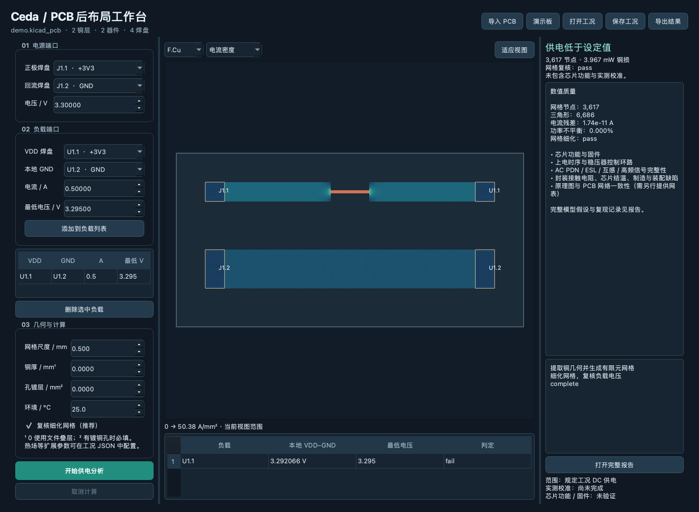

# v0.1 local verification record

Date: 2026-10-14. Execution: macOS 27 / ARM64, Python 3.12.14. Dependency installation was isolated in `.venv`; versions are recorded in `uv.lock`.

## Completed locally

- 29 tests passed. Includes PCB fill/rotation/cutout handling; explicit unsupported-geometry failures; full-width copper strip vs analytic loop resistance; neck vs wide-plane comparison; physical disconnect rejection; local ground shift; explicit via barrel resistance; node budget; finite input validation; power/thermal conservation; report input hash; netlist mismatch; ngspice startup bridge; desktop worker and screenshot.
- `uv sync --frozen --extra dev --offline` completed against cached dependencies, followed by 29 passing tests.
- Python source compilation completed.
- macOS ARM `Ceda.app` built with PyInstaller; both packaged CLI and packaged desktop worker ran the synthetic demo successfully.
- Packaged and source demo yielded identical load voltage: **3.292066123708791 V** at 0.5 A from a 3.3 V ideal source.
- Demo's threshold is deliberately 3.295 V: the correct engineering verdict is **fail**, not a program failure.
- Fine mesh: 3,617 nodes / 6,686 triangles. 0.5 mm→0.25 mm load-voltage difference: 0.0000500098 V. Total copper loss: 0.0039669381 W. Relative electrical power imbalance: 2.6625e-10.
- Optional ngspice single-port layout-R / RC transient generated 2,024 samples. Final load voltage: 3.29206612 V. Extracted loop R: 0.0158677526 Ω.

The native macOS window was also opened successfully. Terminal, offscreen Qt and native-window checks validate execution/rendering, not full user acceptance or hardware accuracy. The screenshot below comes from a completed analysis, not a mockup.

## White workbench visual update

The user selected preview A. The native Qt layout and reports now use white backgrounds, light dividers and project navigation, a focused copper canvas, a right inspector and a bottom result table. The original imagegen artwork is used by the window, navigation brand and macOS/Windows application icon formats. Three standalone HTML previews remain under `design/previews`.

All 29 existing tests passed after the layout change. A screenshot review caught and corrected a Qt stylesheet/NoButtons issue that reduced numerical editor width to one pixel; values are now visibly readable. The solver input and numerical result for the synthetic demo are unchanged.

## Outstanding evidence

- Windows/Linux CI jobs are configured but have not run in this local session.
- No fabricated-board measurement or model calibration has been performed.
- No official full KiCad DRC/ERC pass is claimed. The current machine's KiCad application folder contains broken application links; native PCB parsing does not depend on that installation.
- Thermal output is an experimental thickness-averaged model; passing energy balance does not validate junction temperatures or real convection accuracy.
- The app is a local development build with ad-hoc signing, not a notarized public release or a license-complete redistribution package.

## PCB viewport revision (2026-10-15)

Geometry regression tests cover exact arc endpoints, KiCad absolute pad angles, transformed silkscreen, rotated nonplated slots, mask openings, triangulation with cutouts, VRML units/DEF/USE/transforms, back-side model placement, and input-order-independent depth-buffer occlusion. Real-board display was exercised against KiCad's unmodified StickHub example (94 footprints, 273 pads, 87 vias); visual geometry and numerical validation are separate evidence levels. See `03_真实PCB呈现与KiCad参考.md` for source links, local-only fixture licensing and remaining limits.

Final automated result: **39 passed**, including a complete asynchronous 3D loader/rasterizer lifecycle. Packaged STEP conversion and a packaged real-board 3D software-render capture succeeded. The native macOS GPU viewport was started, but its final visual inspection was interrupted by the Mac locking; GPU visual acceptance is still pending and is not included in the automated pass count. Windows/Linux GUI and model-loader smoke checks have not been run here.

## SwiftUI migration (2026-10-17)

- Python suite: **42 passed**, including native geometry/binary contracts and rejection of a changed PCB before solving.
- Native Swift contract/process checks: **11 passed** (version rejection, millimetre pan/zoom mapping, invalid coordinates, truncated mesh, mismatched board identity, Unicode progress, nonzero worker exit, cancellation).
- SwiftUI release build and complete native app packaging succeeded using Command Line Tools. The bundle is locally ad-hoc signed; signature verification passed.
- Production Metal renderer, on the current Apple M4 GPU: the actual StickHub export rendered **995,544 vertices**, with **86/93 model references** loaded. Missing/read-warning limits remain explicit. This is genuine Metal GPU rendering, not a Qt software screenshot.
- The real SwiftUI window was opened through the native UI tool. “打开合成演示板” imported source/config; “开始供电分析” completed through the bundled engine; accessibility output showed **U1.1, 3.292066 V, threshold 3.2950, 低于设定值**. This matches the numerical engine.
- ScreenCaptureKit failed with stream errors during attempted window screenshots. Screenshot-level visual acceptance and the remaining native file dialogs/3D gestures are not claimed complete on this host. GPU texture rendering and window import/analysis controls are verified separately.
- No measured-board accuracy calibration, Intel Mac validation or Windows/Linux native SwiftUI port is claimed. Existing cross-platform core checks remain configured independently.
